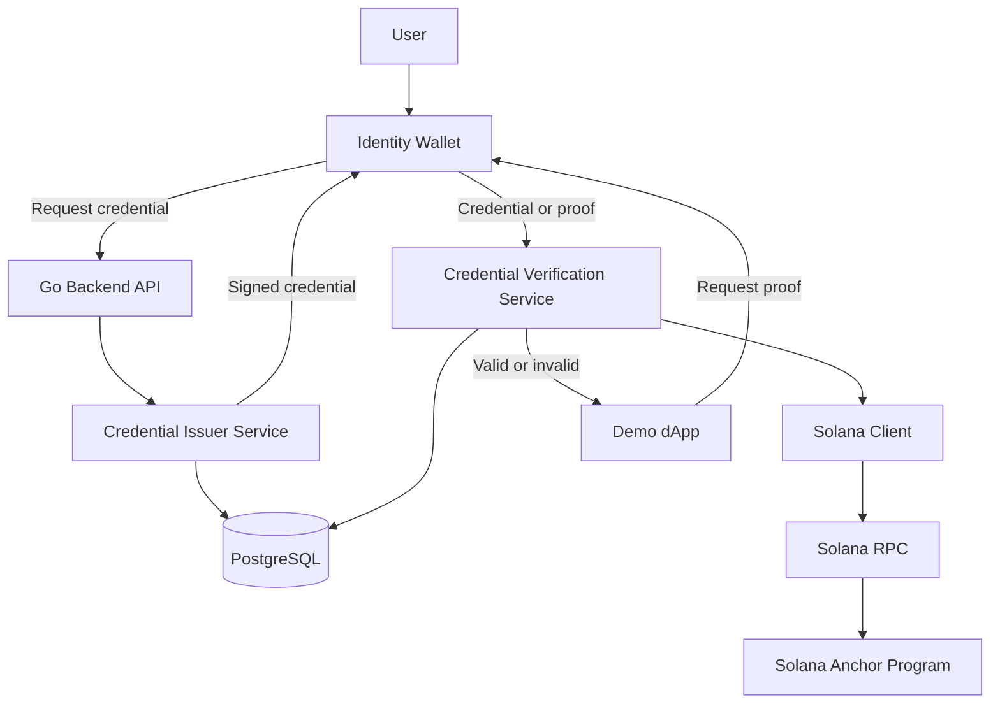
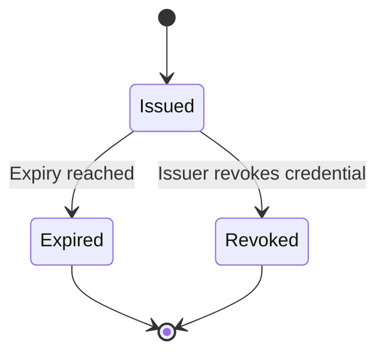
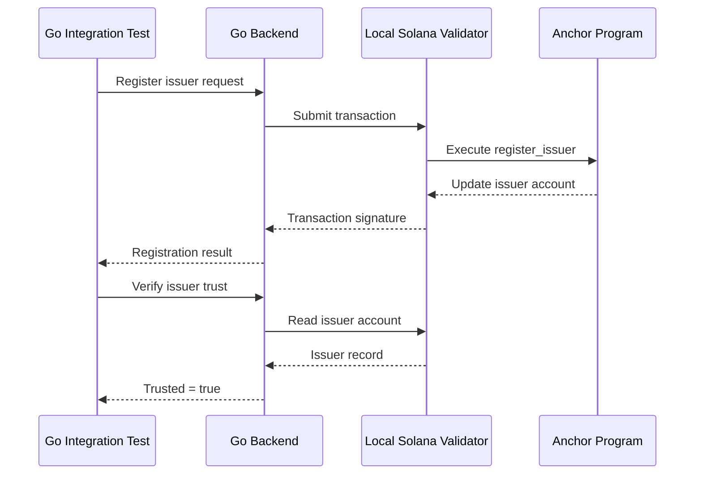

# Technical Design Document: Decentralized KYC on Solana

**Status:** Proposed  
**Version:** 0.1.0  
**Backend:** Go  
**Blockchain:** Solana  
**On-chain program:** Rust + Anchor  
**Initial deployment:** Local validator, followed by Solana Devnet  
**Project objective:** Build a privacy-preserving, reusable KYC credential system that allows users to prove their verification status to multiple applications without repeatedly sharing their identity documents.

---

## 1. Overview

### 1.1 Problem Statement

Traditional KYC requires users to submit identity documents to individual applications. This creates repeated onboarding friction, duplicated data storage, and unnecessary exposure of personally identifiable information (PII).

This project aims to build a reusable identity system in which:

1. A trusted issuer verifies a user's identity.
2. The issuer creates a cryptographically signed credential.
3. The user stores and presents the credential through an identity wallet.
4. Applications verify the credential without needing the original identity documents.
5. Solana provides a shared registry of trusted issuers and credential-status information.

### 1.2 Design Principles

- **Privacy first:** No identity documents, names, birthdates, addresses, or raw credentials on-chain.
- **Off-chain first:** Identity issuance and credential verification should work independently of blockchain availability where possible.
- **User controlled:** Users control their wallet and credential presentation.
- **Portable credentials:** Credentials should be usable across compatible applications.
- **Minimal on-chain state:** Solana stores only the information needed to coordinate trust and validity.
- **Standards-oriented:** Avoid inventing cryptographic credential formats when established standards can be used.
- **Incremental delivery:** Every development phase should produce a working, testable result.

### 1.3 MVP Scope

The first working version will demonstrate this flow:

> A user receives a KYC credential from an issuer, stores it locally, and uses it to access a demo application that verifies the credential and checks the issuer's trust status on Solana.

The MVP will use simulated KYC results. It will not initially perform real government-ID verification or claim regulatory compliance.

---

## 2. System Architecture

### 2.1 Component Diagram



The diagram represents logical components, not necessarily separate deployable services. For the MVP, the issuer, verification service, and Solana client can live inside one Go application.

### 2.2 Component Responsibilities

| Component | Responsibility |
|---|---|
| Identity Wallet | Holds the user's private key and credentials; presents credentials to applications |
| Go Backend API | Exposes HTTP endpoints and coordinates issuance and verification |
| Issuer Service | Simulates KYC approval and signs credentials |
| Verification Service | Validates signatures, expiry, credential status, and issuer trust |
| PostgreSQL | Stores issuer metadata, issuance records, and operational state |
| Solana Client | Submits transactions and reads on-chain accounts |
| Solana Program | Maintains issuer registration and credential-status records |
| Demo dApp | Demonstrates reusable KYC verification |

### 2.3 Trust Boundaries

The system has three distinct trust boundaries:

1. **Issuer trust:** An issuer is responsible for the correctness of the identity checks behind its credentials.
2. **Credential trust:** Cryptographic signatures prove that a credential was issued by a particular key; they do not independently prove that the underlying KYC was performed correctly.
3. **Blockchain trust:** Solana records the program-controlled status of issuers and credentials. It does not validate a user's passport or establish that an issuer is legally authorized to conduct KYC.

The verifier must validate all three layers separately.

---

## 3. Technology Stack

| Layer | Proposed technology |
|---|---|
| Backend language | Go |
| HTTP routing | Go standard library or Chi |
| Credential signing | Go `crypto/ed25519` initially |
| API schema | OpenAPI |
| Database | PostgreSQL |
| Database access | `pgx` |
| Blockchain | Solana |
| Solana program | Rust + Anchor |
| Go Solana client | `github.com/solana-foundation/solana-go` |
| Local blockchain testing | Solana test validator / Anchor testing workflow |
| Backend testing | Go `testing` package |
| API integration testing | `httptest` and a test HTTP client |
| Configuration | Environment variables |
| Containerization | Docker Compose, when needed |

**Go SDK decision:** Use the stable v1 line of `github.com/solana-foundation/solana-go` initially. Pin the selected version in `go.mod` rather than depending on an unpinned latest release. The library provides Solana RPC, wallet, transaction, and program integrations. Its documentation also notes that it is actively developed and unaudited, so it should be isolated behind an internal adapter.

Reference: https://github.com/solana-foundation/solana-go

### 3.1 Language Boundary

Go is responsible for the backend and blockchain client. It is not responsible for implementing the Solana program itself.

```text
Go Backend
    |
    | JSON-RPC transactions / account reads
    v
Solana Runtime
    |
    v
Rust + Anchor Program
```

This separation lets us develop and test most business logic without requiring blockchain execution.

---

## 4. Identity and Credential Model

### 4.1 Credential Format

The MVP should use a versioned, signed credential envelope that can later be mapped to an interoperable Verifiable Credential format.

Target standards:

- W3C Decentralized Identifiers (DID): https://www.w3.org/TR/did-1.0/
- W3C Verifiable Credentials Data Model 2.0: https://www.w3.org/TR/vc-data-model-2.0/

For the first implementation, a signed JWT-based credential is a reasonable simplification, provided the implementation clearly documents which parts of the W3C data model it supports. Full standards conformance should be a separate decision, not an implied guarantee.

Example logical credential payload:

```json
{
  "iss": "did:web:issuer.example",
  "sub": "did:example:user-123",
  "jti": "random-unique-credential-id",
  "iat": 1793000000,
  "exp": 1795592000,
  "credential_type": "KYCStatus",
  "claims": {
    "kyc_verified": true,
    "over_18": true,
    "country": "ID"
  }
}
```

This is an illustrative payload, not a finalized interoperable credential schema.

Important implementation rules:

- The issuer signs the credential.
- The credential must have a unique identifier and explicit expiry.
- The credential format and signature algorithm must be versioned.
- The verifier must reject unsupported algorithms and malformed credentials.
- Never accept an unsigned credential simply because its payload looks valid.
- Avoid using a public wallet address as a globally reusable identity identifier unless necessary.

For the initial implementation, `sub` may be a user-controlled public key or a DID linked to the user's wallet. Later phases should consider pairwise identifiers to reduce cross-application correlation.

### 4.2 Credential Signing Keys

Use a dedicated issuer signing key, separate from the Solana transaction-signing key.

```text
Issuer Signing Key
    └── Signs credentials

Solana Authority Key
    └── Signs blockchain transactions
```

These keys have different purposes and should have independent access controls.

For local development, keys may be generated locally and loaded from ignored development configuration. Production credentials should use a managed key store or HSM where appropriate.

Never commit private keys, seed phrases, or production secrets to Git.

### 4.3 Credential Lifecycle



A credential is accepted only when:

- its signature is valid;
- its issuer is trusted;
- it is within its validity period;
- it has not been revoked;
- the presented proof satisfies the application's policy.

Revocation is irreversible for a given credential ID in the initial design. If a user is reverified, the issuer creates a new credential.

---

## 5. Solana Program Design

### 5.1 MVP On-chain Scope

The first on-chain program should maintain two kinds of records:

1. **Issuer Registry:** Which issuer identities are trusted by this system?
2. **Credential Status Registry:** Is a credential reference valid, revoked, or otherwise inactive?

Do not implement an NFT yet. The initial product does not require token ownership or NFT transfer mechanics to demonstrate reusable KYC.

A normal token can be transferred, which is inappropriate for identity credentials. A non-transferable token introduces additional complexity without solving credential verification by itself.

### 5.2 Account Model

Solana programs use accounts for persistent state. We will use Program Derived Addresses (PDAs) to derive predictable registry account addresses.

Proposed logical account structures:

**RegistryConfig**

```text
RegistryConfig
- authority: Pubkey
- paused: bool
- version: u8
- bump: u8
```

**IssuerRecord**

```text
IssuerRecord
- issuer_id: [u8; 32]
- issuer_signing_key: Pubkey
- active: bool
- created_at: i64
- bump: u8
```

**CredentialStatus**

```text
CredentialStatus
- credential_ref: [u8; 32]
- issuer_id: [u8; 32]
- status: u8
- expires_at: i64
- bump: u8
```

These are logical specifications; final Anchor account serialization and size allocation must be defined during implementation.

`credential_ref` should be a randomly generated opaque identifier, not a hash of predictable personal data or the raw credential. This reduces the risk of correlating on-chain records with known users.

### 5.3 PDA Derivation

Use deterministic seeds with explicit domain separation.

```text
RegistryConfig:
    ["registry_config"]

IssuerRecord:
    ["issuer", issuer_id]

CredentialStatus:
    ["credential", credential_ref]
```

The program ID is included in PDA derivation by Solana's mechanism.

Do not use variable-length, ambiguous seed concatenations. Use fixed-size identifiers where possible.

Reference: https://solana.com/docs/core/pda

### 5.4 Instructions

Initial instruction set:

| Instruction | Purpose | Authorization |
|---|---|---|
| `initialize_registry` | Creates registry configuration | Initial authority |
| `register_issuer` | Registers a trusted issuer | Registry authority |
| `set_issuer_status` | Activates or suspends an issuer | Registry authority |
| `register_credential` | Creates a credential-status record | Authorized issuer authority |
| `revoke_credential` | Marks a credential as revoked | Credential issuer or authorized authority |
| `update_registry_authority` | Changes registry administration | Current authority |

The exact account constraints and authority model must be implemented and tested in Anchor.

**Important:** The Go backend must not be able to register arbitrary issuers merely because it can call the program. The on-chain program must enforce authorization independently.

### 5.5 Credential Validity Rules

The backend must treat a credential as valid only if all relevant conditions hold:

```text
credential_signature_valid
AND issuer_registered
AND issuer_active
AND credential_not_expired
AND credential_not_revoked
AND subject_binding_valid
AND requested_policy_satisfied
```

The chain is not a replacement for signature verification. The backend verifies the credential signature locally and reads the relevant registry accounts from Solana.

For the first version, use a single designated issuer authority and a single registry authority. A multi-issuer governance system can be introduced later.

### 5.6 Events and Auditability

Program instructions should emit events or otherwise produce a clear transaction history for:

- issuer registration;
- issuer suspension;
- credential registration;
- credential revocation;
- authority changes.

Events must not include personal information or full credential contents.

---

## 6. Go Backend Design

### 6.1 Suggested Package Structure

Start with a modular monolith rather than separate microservices.

```text
identity-kyc/
├── cmd/
│   └── api/
│       └── main.go
├── internal/
│   ├── config/
│   │   └── config.go
│   ├── http/
│   │   ├── router.go
│   │   ├── middleware.go
│   │   └── handlers/
│   ├── identity/
│   │   ├── model.go
│   │   └── service.go
│   ├── credential/
│   │   ├── model.go
│   │   ├── signer.go
│   │   ├── verifier.go
│   │   └── service.go
│   ├── issuer/
│   │   ├── model.go
│   │   └── service.go
│   ├── verification/
│   │   ├── policy.go
│   │   └── service.go
│   ├── blockchain/
│   │   ├── client.go
│   │   ├── solana.go
│   │   ├── accounts.go
│   │   └── transactions.go
│   ├── repository/
│   │   ├── interfaces.go
│   │   └── postgres/
│   └── app/
│       └── app.go
├── migrations/
├── contracts/
│   └── kyc-registry/
│       ├── Anchor.toml
│       ├── Cargo.toml
│       ├── programs/
│       └── tests/
├── api/
│   └── openapi.yaml
├── scripts/
├── .env.example
├── .gitignore
├── go.mod
├── go.sum
├── Makefile
└── README.md
```

This is a target layout, not a requirement to create every file during initialization. Add packages when their responsibilities become real.

### 6.2 Dependency Direction

```text
HTTP Handlers
      |
      v
Application / Domain Services
      |
      +------ Credential Interfaces
      |
      +------ Repository Interfaces
      |
      +------ Blockchain Interface
                    |
                    v
               Solana Adapter
```

Business logic should depend on interfaces, not on the concrete Solana RPC client.

For example:

```go
type ChainVerifier interface {
    IsIssuerTrusted(
        ctx context.Context,
        issuerID [32]byte,
    ) (bool, error)

    GetCredentialStatus(
        ctx context.Context,
        credentialRef [32]byte,
    ) (CredentialStatus, error)
}
```

This is illustrative. Define the actual interface and error types when implementing the first blockchain integration.

The key objective is that credential-signature tests should not require a running Solana validator.

### 6.3 Initial API Endpoints

| Method | Endpoint | Purpose |
|---|---|---|
| `GET` | `/healthz` | Process health |
| `GET` | `/readyz` | Readiness checks |
| `POST` | `/v1/kyc/simulate` | Simulates an approved or rejected KYC result |
| `POST` | `/v1/credentials` | Issues a credential after simulated approval |
| `POST` | `/v1/credentials/verify` | Verifies a presented credential |
| `GET` | `/v1/issuers/{issuerID}` | Retrieves issuer trust information |

The simulation endpoint is strictly for local development. It must not be exposed as a production KYC approval mechanism.

Credential revocation and issuer administration endpoints can be added in later phases.

---

## 7. Data Storage

PostgreSQL is for operational state, not a replacement for the user's wallet.

Initial tables:

**issuers**

- `id`
- `issuer_id`
- `signing_public_key`
- `status`
- `created_at`
- `updated_at`

**credentials**

- `credential_ref`
- `issuer_id`
- `subject_ref`
- `issued_at`
- `expires_at`
- `status`
- `transaction_signature` (nullable)

Avoid storing raw identity documents or full credential payloads in the database by default. The MVP can store issuance metadata and credential references without maintaining a centralized copy of the user's credential.

If real document verification is introduced later, design a separate encrypted document-storage system with strict access control, retention limits, and deletion policies.

The database is an operational index. On-chain records and issuer signatures remain independently verifiable.

---

## 8. Development Phases

Each phase should be completed and tested before expanding the system.

### Phase 0 — Repository and Development Environment

**Goal:** Establish a reproducible development environment.

Tasks:

- Initialize the Go module.
- Set up configuration loading and structured logging.
- Create the HTTP server and health endpoints.
- Establish the proposed package structure.
- Add `.gitignore` and `.env.example`.
- Add a basic Makefile.
- Decide on the supported Go version.
- Install the Solana and Anchor toolchains separately from the Go backend.
- Document local setup.

Acceptance criteria:

- `go test ./...` runs successfully.
- The API starts locally.
- `/healthz` responds successfully.
- No secrets are committed.
- A new developer can follow the README to reproduce the setup.

**Do not build smart contracts in this phase.**

### Phase 1 — Off-chain Credential MVP

**Goal:** Issue and verify a signed credential without blockchain dependencies.

Tasks:

1. Generate a dedicated issuer signing key.
2. Implement the credential data model.
3. Implement credential signing and signature verification.
4. Implement credential expiry validation.
5. Implement the simulated KYC approval flow.
6. Implement the credential issuance endpoint.
7. Implement the credential verification endpoint.
8. Add unit tests for valid and invalid credentials.

Acceptance criteria:

- An approved simulated KYC result produces a signed credential.
- A valid credential passes verification.
- A modified payload fails verification.
- Expired credentials are rejected.
- Credentials signed by an unknown key are rejected.
- No blockchain node is required to run the tests.

### Phase 2 — Solana Registry Program

**Goal:** Implement the minimum on-chain trust registry.

Tasks:

1. Create the Anchor program.
2. Implement registry initialization.
3. Implement issuer registration and suspension.
4. Implement credential-status registration and revocation.
5. Add authority and account-validation constraints.
6. Add Anchor tests.
7. Deploy to a local validator.
8. Document account layouts and PDA derivation.

Acceptance criteria:

- Only authorized administrators can modify issuer trust.
- Only authorized issuer authorities can register or revoke credentials.
- Unauthorized transactions fail.
- Duplicate and invalid state transitions are rejected.
- PDA derivation is deterministic.
- Credential status changes can be read back from the program.

### Phase 3 — Go and Solana Integration

**Goal:** Make the Go backend consume the real on-chain registry.

Tasks:

1. Implement the Solana client adapter.
2. Read issuer records and credential-status accounts.
3. Submit registry transactions using a dedicated signer.
4. Confirm transaction success before reporting state changes as complete.
5. Add retry handling and timeouts.
6. Handle RPC failures and unconfirmed transactions.
7. Implement integration tests against a local validator.

Acceptance criteria:

- Go can initialize or read the registry.
- Go can register an issuer through an authorized transaction.
- Go can retrieve issuer status from Solana.
- Go can register and revoke a credential reference.
- Verification fails closed when the required trust state cannot be established.
- Repeated requests do not accidentally create conflicting records.

### Phase 4 — End-to-end KYC Flow

**Goal:** Demonstrate reusable verification through a demo application.

Tasks:

1. Issue a credential through the API.
2. Store it in a local test wallet or client.
3. Present it to a demo dApp.
4. Verify the issuer's signature.
5. Check the issuer registry and credential status on Solana.
6. Return a verification result to the application.

Acceptance criteria:

- A valid credential from a trusted issuer is accepted.
- An untrusted issuer's credential is rejected.
- A revoked credential is rejected.
- An expired credential is rejected.
- An RPC outage does not cause an unverified credential to be accepted.

### Phase 5 — Wallet and Developer Experience

**Goal:** Make the system usable by real client applications.

Tasks:

- Build a wallet interface or integrate an existing wallet.
- Implement user-controlled credential storage.
- Introduce a challenge-response flow to bind presentation to a user session.
- Add a verifier SDK or integration example.
- Add replay protection, audience binding, and request expiry.
- Document application integration.

Acceptance criteria:

- A verifier can request a specific claim.
- The wallet requires user consent before disclosure.
- Proofs are bound to the intended verifier and session.
- Replayed presentations are rejected.

### Phase 6 — Privacy and Production Hardening

**Goal:** Prepare for realistic identity use cases.

Tasks:

- Evaluate standardized selective-disclosure credentials.
- Evaluate zero-knowledge proofs for claims such as age thresholds.
- Introduce secure key management and rotation.
- Define issuer governance and recovery procedures.
- Perform smart contract security review.
- Define operational monitoring, backup, and incident response.
- Review applicable privacy and KYC regulations before real-user deployment.

Acceptance criteria:

- No personal information is exposed through on-chain accounts, logs, or events.
- Revocation and key-compromise procedures are documented and tested.
- Security and privacy reviews have been completed before production use.

---

## 9. Blockchain Integration and Testing Strategy

### 9.1 Testing Layers

**Layer 1: Unit tests**

Test credential signing, verification, expiry, policy evaluation, and serialization in isolation.

**Layer 2: Program tests**

Test Anchor instructions, account constraints, authorization, and state transitions.

**Layer 3: Local integration tests**

Run the Go backend against a local Solana validator. Submit real transactions and read back the resulting account state.

**Layer 4: Devnet tests**

Validate deployment configuration, RPC behavior, transaction confirmation, signer configuration, and end-to-end workflows.

**Layer 5: Security tests**

Test unauthorized issuers, forged credentials, revoked records, replayed presentations, key rotation, malicious inputs, and RPC failure scenarios.

### 9.2 Integration Test Flow



The integration test should not rely solely on receiving a transaction signature. It should wait for the configured commitment level and confirm that the resulting account state matches the expected state.

### 9.3 Important Failure Cases

| Scenario | Expected behavior |
|---|---|
| RPC timeout | Return an explicit error; do not assume success |
| Transaction rejected | Return the execution error |
| Transaction submitted but not confirmed | Report pending or uncertain status |
| Issuer account missing | Treat issuer as untrusted |
| Issuer suspended | Reject the credential |
| Credential revoked | Reject the credential |
| Credential expired | Reject the credential |
| Invalid account layout | Fail safely and report an integration error |
| Unauthorized instruction | Program rejects the transaction |

### 9.4 Local Validator vs Devnet

Use a local validator for automated tests because it is isolated, reproducible, and suitable for rapid iteration.

Use Devnet for deployment and interoperability testing. Devnet is not a substitute for local integration tests because RPC availability and network conditions are less predictable.

Do not use Mainnet during early development.

Official references:

- Solana core concepts: https://solana.com/docs/core
- Solana PDAs: https://solana.com/docs/core/pda
- Solana Go SDK: https://github.com/solana-foundation/solana-go

---

## 10. Security Requirements

These requirements apply from the beginning, not only in the final phase.

### Credential security

- Sign credentials with a dedicated issuer key.
- Validate signature, issuer, expiry, and credential type.
- Reject malformed inputs and unsupported algorithms.
- Avoid logging complete credentials or authorization headers.

### Blockchain security

- Enforce authorization in the on-chain program.
- Use explicit account ownership and PDA validation.
- Protect registry administration keys.
- Test invalid state transitions and unauthorized access.
- Treat all RPC data as untrusted until validated.

### Privacy

- Never put identity documents or personal attributes on-chain.
- Do not store hashes of predictable personal information as if hashing made them anonymous.
- Use random opaque references for credential-status records.
- Avoid globally linking user wallet addresses to their identity credentials unless required.
- Minimize information returned by the verification API.

### Verification security

- Bind credential presentations to a verifier and a short-lived challenge.
- Prevent replay attacks.
- Distinguish invalid credentials from unavailable verification infrastructure.
- Never treat an RPC outage as proof that a credential is valid.

### Important limitation

A credential marked valid on-chain does not automatically mean the user satisfies every application's compliance requirements. Each relying application must define which issuers, credential types, claim requirements, and freshness policies it accepts.

---

## 11. Decisions Deferred

The following decisions are intentionally postponed until the MVP demonstrates the core flow.

| Decision | Why it is deferred |
|---|---|
| Actual NFT / soulbound token | Not required for initial credential verification |
| Zero-knowledge proofs | Adds cryptographic complexity |
| Multi-chain support | Increases integration and testing scope |
| Multiple issuer governance | Requires a more complex trust model |
| Real KYC provider | Requires vendor integration and compliance review |
| Production mobile wallet | Can follow a successful API proof of concept |
| Off-chain credential encryption and recovery | Depends on the final wallet and storage model |

The initial system should prove that reusable credentials and blockchain-backed issuer trust work before these features are introduced.

---

## 12. Initial Implementation Checklist

Start with Phase 0 and move into Phase 1 only after the server skeleton is running.

- [ ] Create the Git repository.
- [ ] Initialize `go.mod`.
- [ ] Create `cmd/api/main.go`.
- [ ] Add configuration loading.
- [ ] Add HTTP routing and `/healthz`.
- [ ] Add structured logging.
- [ ] Create the initial package structure.
- [ ] Add `.env.example` and `.gitignore`.
- [ ] Add a Makefile with `run`, `test`, and `lint` targets.
- [ ] Add a README with local setup instructions.
- [ ] Run `go test ./...`.
- [ ] Implement the credential model and signer.
- [ ] Write unit tests before adding Solana integration.

### Suggested first milestone

The first milestone is deliberately simple:

**Issue a signed test credential, verify it successfully, tamper with one claim, and prove that verification rejects it.**

Once this works, we have a stable off-chain foundation. Solana can then be integrated as an independent trust layer rather than entangling blockchain behavior with the first credential implementation.